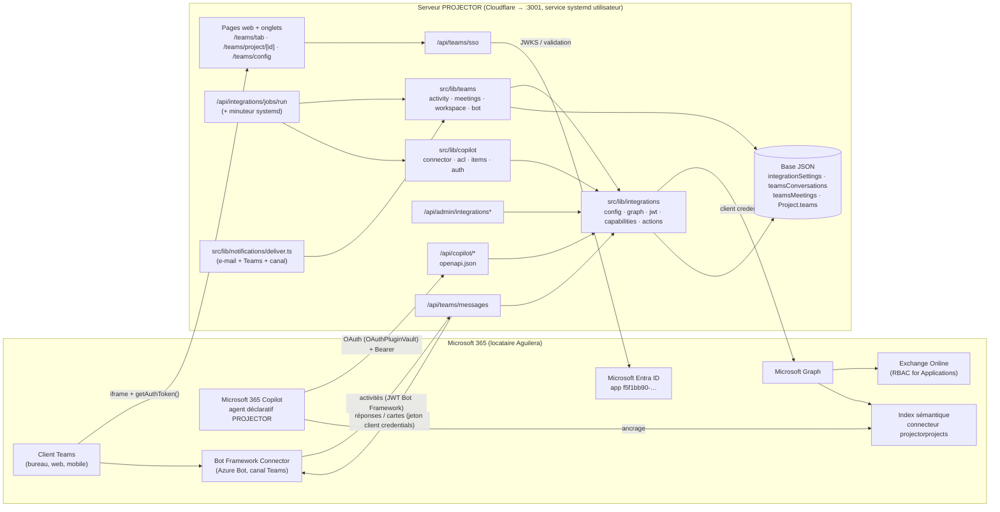
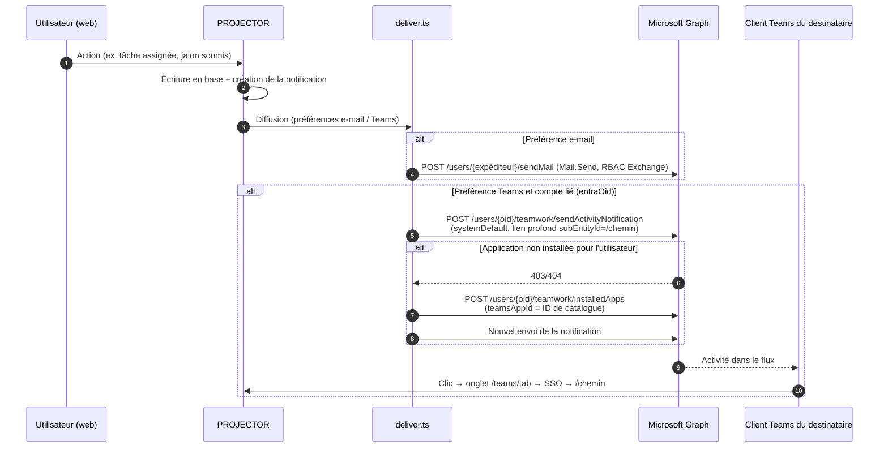
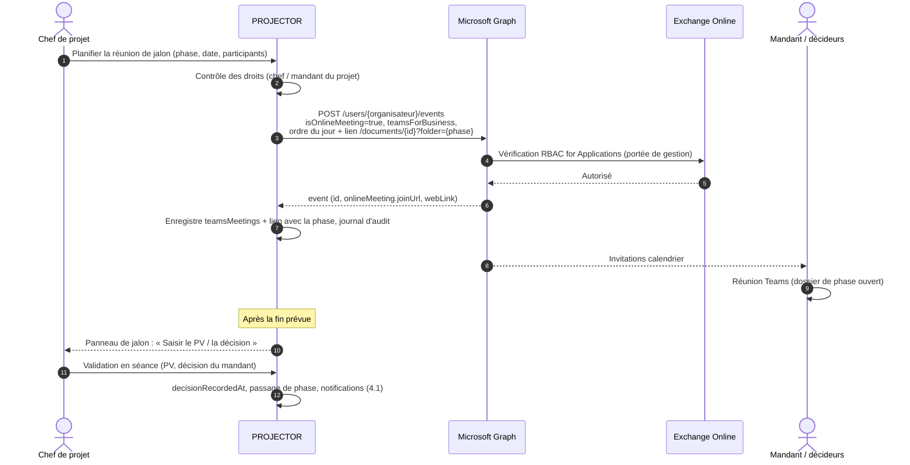
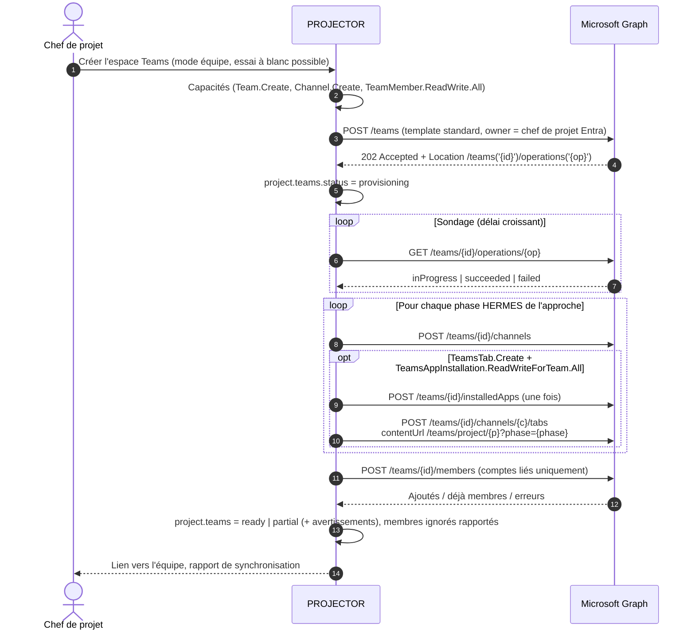
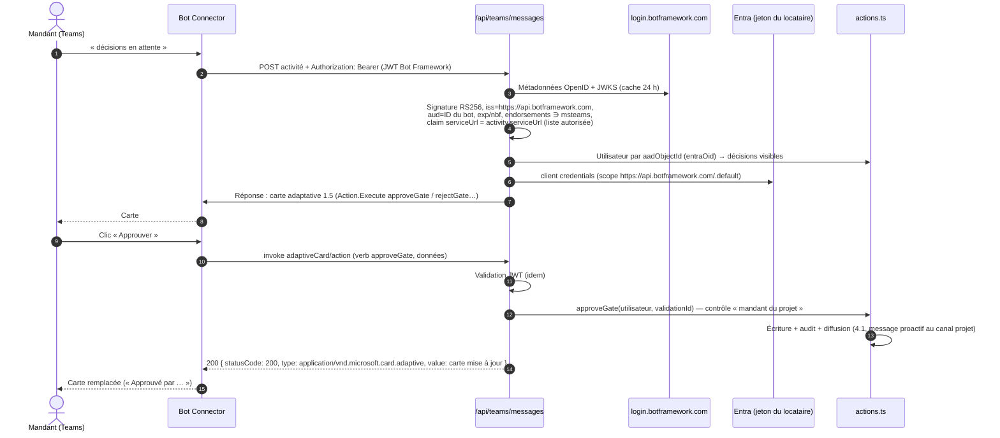
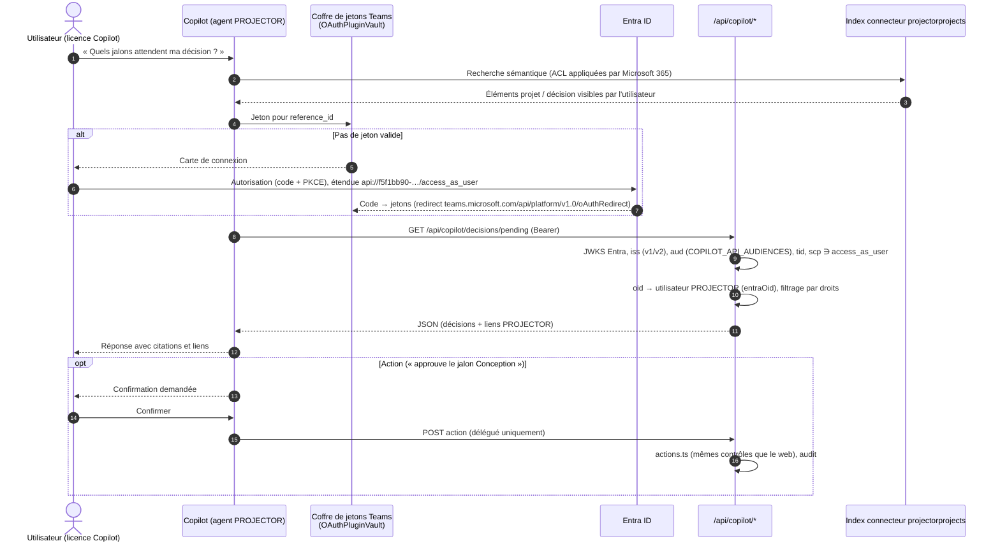
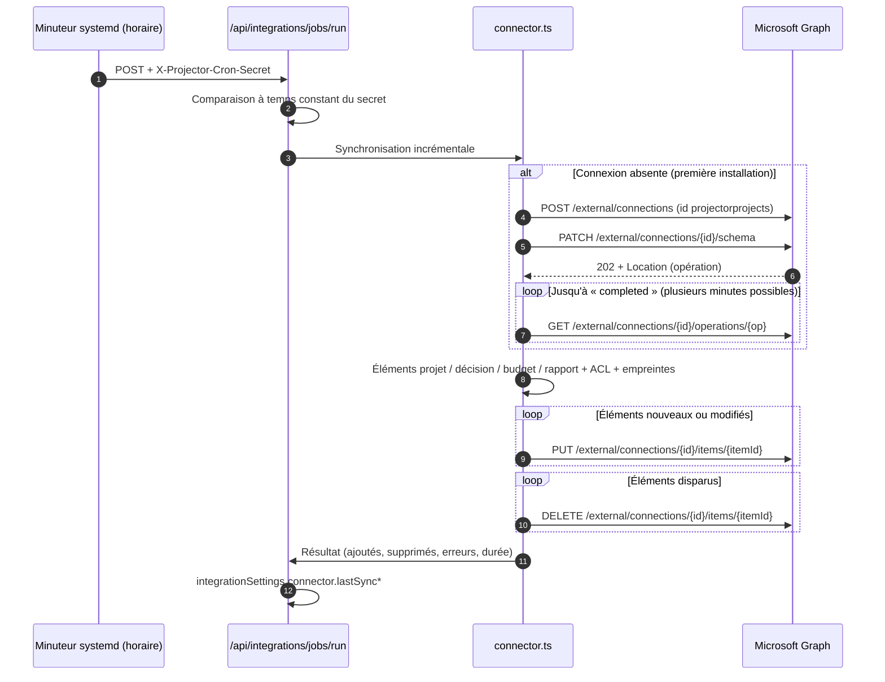

# Intégration Microsoft Teams & Copilot — PROJECTOR

> Document de conception et guide de mise en place.
> Application : PROJECTOR (Next.js 16, HERMES 5.1) — https://projector.aguilera.ch
> Locataire Microsoft 365 : `c4691421-eeae-4c7e-bd67-17849bca6c78` (mono-locataire)

## Sommaire

1. [Contexte et objectifs](#1-contexte-et-objectifs)
2. [Architecture d'ensemble](#2-architecture-densemble)
3. [Fonctionnalités par lot](#3-fonctionnalités-par-lot)
4. [Diagrammes de séquence](#4-diagrammes-de-séquence)
5. [Modèle de données](#5-modèle-de-données)
6. [Permissions Microsoft Graph et Bot Framework](#6-permissions-microsoft-graph-et-bot-framework)
7. [Sécurité](#7-sécurité)
8. [Mise en place (administrateur)](#8-mise-en-place-administrateur)
9. [Plan de test](#9-plan-de-test)
10. [Limites connues](#10-limites-connues)
11. [Plan de déploiement](#11-plan-de-déploiement)
12. [État de la mise en place](#12-état-de-la-mise-en-place)

---

## 1. Contexte et objectifs

PROJECTOR gère les projets selon HERMES 5.1 : phases, jalons (quality gates) validés par le mandant,
budget et révisions, tâches, rapports et documents de phase. Les équipes travaillent au quotidien dans
Microsoft Teams ; l'objectif est d'y amener PROJECTOR **sans dupliquer la logique métier** :

| Objectif | Moyen |
| --- | --- |
| Être notifié là où l'on travaille | Flux d'activité Teams (en plus ou à la place de l'e-mail) |
| Préparer et tenir les jalons de phase | Réunions Teams planifiées depuis PROJECTOR, lien vers le dossier de phase, saisie du PV |
| Collaborer par projet | Équipe ou canal Teams par projet, canal par phase HERMES, membres synchronisés |
| Consulter PROJECTOR sans changer d'outil | Onglet personnel « Mes tâches », onglets de projet/phase dans canaux et réunions, SSO |
| Décider vite | Bot : cartes adaptatives d'approbation (jalon, révision budgétaire), tâches |
| Interroger son portefeuille en langage naturel | Agent déclaratif Copilot + plug-in API + connecteur Graph |

Principes directeurs :

- **PROJECTOR reste la source de vérité** : Teams/Copilot n'exposent que des vues et des actions passant
  par la couche d'actions PROJECTOR (mêmes contrôles de droits que l'interface web).
- **Une seule inscription d'application Entra** (`f5f1bb90-afec-4e0d-9500-2f6e970ef5a9`) : Graph
  (client credentials), bot, SSO des onglets, API Copilot.
- **Moindre privilège** : chaque fonctionnalité déclare ses rôles requis ; le panneau d'administration
  vérifie les rôles réellement présents dans le jeton d'application et désactive proprement ce qui manque.
- **Aucune dépendance npm ajoutée** : `fetch`, WebCrypto, SDK Teams JS chargé depuis le CDN Microsoft.

## 2. Architecture d'ensemble



Socle commun (déjà en place) :

| Module | Rôle |
| --- | --- |
| `src/types/integrations.ts` | Types : `IntegrationSettings`, `TeamsConversationRef`, `ProjectTeamsWorkspace`, `TeamsMeeting` |
| `src/lib/integrations/config.ts` | Variables d'environnement, ID de l'app Teams, audiences de l'API, liens profonds |
| `src/lib/integrations/graph.ts` | Client Graph « client credentials » avec cache de jeton, rôles décodés du jeton |
| `src/lib/integrations/jwt.ts` | Validation RS256 par JWKS (Bot Framework, Entra), sans dépendance |
| `src/lib/integrations/capabilities.ts` | Rapport de capacités : rôles requis/optionnels par fonctionnalité |
| `src/lib/integrations/actions.ts` | Couche d'actions contrôlant les droits (bot + Copilot) |
| `src/lib/notifications/deliver.ts` | Diffusion après écriture en base : e-mail, flux d'activité, canal projet |

## 3. Fonctionnalités par lot

### Lot 1 — Notifications et réunions

**Flux d'activité Teams** (`src/lib/teams/activity.ts`)

- `POST /users/{oid}/teamwork/sendActivityNotification`, `activityType: "systemDefault"`, sujet = texte
  source + lien profond vers l'onglet personnel :
  `https://teams.microsoft.com/l/entity/<teamsAppId>/projector-tasks?webUrl=…&context={"subEntityId":"<chemin>"}`.
  L'onglet ouvre ensuite directement le chemin PROJECTOR (`/projets/<id>`, `/taches`…).
- Si l'application n'est pas installée pour l'utilisateur et que l'ID de catalogue est connu
  (`TEAMS_APP_CATALOG_ID` ou panneau d'administration), installation automatique
  (`TeamsAppInstallation.ReadWriteSelfForUser.All`) puis nouvel essai.
- Préférence par utilisateur (profil) : e-mail, Teams, les deux, aucun
  (`User.emailNotifications` / `User.teamsNotifications`) ; Teams uniquement si le compte est lié à Entra (`entraOid`).
- Nouveaux types : `task_overdue` (scan quotidien des tâches en retard), `report_available`.

**Réunions de jalon de phase** (`src/lib/teams/meetings.ts`)

- `POST /users/{organisateur}/events` avec `isOnlineMeeting: true`, `onlineMeetingProvider: "teamsForBusiness"`.
- Organisateur : l'utilisateur PROJECTOR s'il est lié à Entra, sinon `TEAMS_MEETING_ORGANIZER` (défaut `MAIL_FROM`).
- Participants : mandant, chef de projet, décideurs ; ordre du jour + lien vers le dossier de phase
  `/documents/<projectId>` (le classeur s'ouvre sur la phase en cours).
- Stockée dans `teamsMeetings`, liée à la phase ; lien de participation affiché dans le panneau de jalon ;
  après la fin, invitation à saisir le PV / la décision (flux de validation en séance existant).
- Option : réunion de suivi récurrente hebdomadaire ou bimensuelle.
- Routes : `GET/POST /api/projects/[id]/teams/meetings`, `DELETE /api/projects/[id]/teams/meetings/[meetingId]`.

### Lot 2 — Espaces de travail Teams

`src/lib/teams/workspace.ts`

- **Équipe dédiée** : `POST /teams` (modèle `standard`), propriétaire = chef de projet (utilisateur Entra,
  obligatoire en mode application), réponse `202` + sondage de l'opération asynchrone.
- **ou canal** dans une équipe existante choisie (`GET /api/integrations/teams/list`).
- Un canal par phase HERMES de l'approche du projet (classique : initialisation → clôture ; agile :
  initialisation → exécution → clôture).
- Synchronisation des membres depuis l'équipe projet PROJECTOR (chef, mandant, assignés, ressources
  partagées du portefeuille) — uniquement les comptes liés (`entraOid`) ; invités et comptes non liés
  rapportés comme ignorés ; mode « essai à blanc ».
- Onglets PROJECTOR par canal : `contentUrl https://projector.aguilera.ch/teams/project/<projectId>?phase=<phase>`,
  `entityId projector-project-<projectId>-<phase|general>` — conditionné par `TeamsTab.Create` +
  `TeamsAppInstallation.ReadWriteForTeam.All` (messages d'administration si absents).
- Synchronisation SharePoint des dossiers de phase : ébauche conditionnée par `Sites.Selected`.
- Routes : `GET/POST/DELETE /api/projects/[id]/teams/workspace`, `POST /api/projects/[id]/teams/workspace/members`.
  Option à la création de projet + bouton sur la page projet.

### Onglets Teams et authentification unique (SSO)

| Page | Usage |
| --- | --- |
| `/teams/tab?view=tasks` | Onglet personnel « Mes tâches » (`entityId projector-tasks`), cible des liens profonds |
| `/teams/project/<id>?phase=<phase>` | Onglet de canal / conversation / réunion : projet ou dossier de phase |
| `/teams/config` | Configuration de l'onglet (choix du projet et de la phase) |
| `POST /api/teams/sso` | Échange du jeton SSO Teams contre une session PROJECTOR |

Fonctionnement :

1. La page charge le SDK Teams JS v2 (CDN Microsoft, version épinglée **2.58.0** avec empreinte SRI),
   appelle `app.initialize()` puis `app.getContext()` (langue, thème, `page.subPageId`).
2. `authentication.getAuthToken()` renvoie un jeton d'accès Entra pour
   `api://projector.aguilera.ch/f5f1bb90-…` (étendue `access_as_user`).
3. `POST /api/teams/sso` valide le jeton (signature JWKS Entra, émetteur v1/v2 du locataire, audience,
   `tid`, `scp`), relie le compte via la logique de connexion Microsoft existante (`resolveEntraLogin` :
   par `oid`, puis e-mail, invitation ou correspondance de rôle), puis ouvre une session **intégrée**
   (`createEmbeddedSession` : cookie `projector-session` `SameSite=None; Secure; Partitioned`).
4. La page redirige dans l'iframe vers le chemin demandé (validé côté serveur : chemin interne uniquement).

Hors de Teams, les pages proposent simplement d'ouvrir PROJECTOR. Les libellés existent en 5 langues
(fr, en, it, es, de), choisies selon la langue Teams.

### Administration — « Microsoft Teams & Copilot »

Paramètres › Administration :

- **Vérification des capacités** : rôles présents dans le jeton d'application (par fonctionnalité, requis /
  optionnels), obtention d'un jeton Bot Framework, ID de catalogue Teams, état du connecteur.
- **Activation par fonctionnalité** : `activityFeed`, `meetings`, `workspaces`, `tabs`, `sharepoint`,
  `bot`, `proactive`, `connector`, `copilotApi`.
- **Boutons** : activité de test vers moi, réunion de test (création + suppression), exécuter les tâches
  planifiées, installer / synchroniser le connecteur.
- Routes : `GET/PATCH /api/admin/integrations`, `POST /api/admin/integrations/test`,
  `POST /api/admin/integrations/jobs`, `/api/admin/integrations/connector`.

**Tâches planifiées** (`src/lib/integrations/jobs.ts`) : tâches en retard, météo projet → alertes rouges,
synthèse hebdomadaire (lundi), synchronisation incrémentale du connecteur. Déclenchement :
`POST /api/integrations/jobs/run` avec l'en-tête `X-Projector-Cron-Secret` (minuteur systemd horaire
`deploy/projector-integrations.{service,timer}`) ou intervalle en processus `PROJECTOR_JOBS_INTERVAL_MIN`.

### Lot 3 — Bot Teams

- Point de terminaison Bot Framework `/api/teams/messages` (fetch simple, sans SDK).
- Validation JWT des jetons Bot Connector (voir § 7), réponses avec un jeton du point de terminaison
  du locataire (`scope https://api.botframework.com/.default`).
- Commandes (FR/EN/IT/ES/DE) : « mes tâches », « état <projet> », « décisions en attente », « aide ».
- Cartes adaptatives 1.5 avec `Action.Execute` : `approveGate`, `rejectGate`, `approveBudget`,
  `rejectBudget`, `completeTask`, `commentTask` (+ compatibilité `Action.Submit`).
- Correspondance `aadObjectId` Teams → utilisateur PROJECTOR (`entraOid`).
- Références de conversation capturées à l'installation / `conversationUpdate` (`teamsConversations`).
- Messages proactifs vers les canaux projet : changement de phase, météo rouge, synthèse hebdomadaire.
- Extension de messagerie : commande `searchProjector` (paramètre `query`) + aperçu des liens
  (`composeExtension/queryLink`) pour `projector.aguilera.ch`.

### Lot 4 — Copilot

- **Connecteur Graph** `projectorprojects` : `ExternalConnection` + schéma (enregistrement asynchrone) ;
  éléments projet / décision / budget / rapport avec ACL reflétant la visibilité PROJECTOR (jamais
  « everyone ») ; groupe d'administration de repli ; synchronisation incrémentale par empreintes.
- **API Copilot** `/api/copilot/*` : jetons Bearer Entra — délégué (`access_as_user`, utilisateur par `oid`)
  ou application (rôles `Projector.Read.All` / `Projector.ReadWrite.All`, lecture seule pour les démons) ;
  repli sur le cookie de session. Ressources : moi, projets, détail, tâches, mes tâches, décisions en
  attente, rapport d'état ; actions (terminer/commenter une tâche, approuver/refuser jalon et révision
  budgétaire — en délégué uniquement). Spécification : `GET /api/copilot/openapi.json`.
- **Agent déclaratif** : `teams-app/copilot/{declarativeAgent.json, ai-plugin.json, openapi.json}`,
  authentification du plug-in `OAuthPluginVault` (`reference_id` = `{{OAUTH_REFERENCE_ID}}`, substitué
  à la construction du paquet). Documentation de l'API : `docs/api-copilot.md`.

### Paquet d'application Teams

| Élément | Valeur |
| --- | --- |
| Manifeste | `teams-app/manifest.json`, schéma **v1.19** |
| ID de l'application (manifeste) | `f800790d-3a30-4c4a-958e-f8fa4c8b9107` (`TEAMS_APP_ID`) |
| Bot / extension de messagerie | `f5f1bb90-afec-4e0d-9500-2f6e970ef5a9` |
| SSO (`webApplicationInfo`) | `api://projector.aguilera.ch/f5f1bb90-afec-4e0d-9500-2f6e970ef5a9` |
| Icônes | `color.png` 192×192, `outline.png` 32×32 blanc/transparent (`scripts/teams/generate-icons.mjs`) |
| Agent Copilot | `copilotAgents` injecté par `scripts/teams/build-teams-app.sh` uniquement si l'agent est demandé |

## 4. Diagrammes de séquence

### 4.1 Notification dans le flux d'activité



### 4.2 Réunion de jalon de phase et saisie de la décision



### 4.3 Provisionnement de l'espace de travail (création d'équipe asynchrone)



### 4.4 Message au bot et approbation par `Action.Execute`



### 4.5 Question à Copilot (plug-in API OAuth + ancrage connecteur)



### 4.6 Synchronisation du connecteur Graph



## 5. Modèle de données

Base JSON (`src/lib/db/store.ts`), normalisation rétrocompatible (valeurs par défaut au chargement).

| Élément | Type / emplacement | Contenu |
| --- | --- | --- |
| `integrationSettings` | Collection (document unique) | Fonctionnalités actives, `teamsAppCatalogId`, `botServiceUrl`, état du connecteur (connexion, schéma, empreintes, dernière synchro), météo par projet, horodatages des tâches |
| `teamsConversations` | Collection `TeamsConversationRef[]` | Références Bot Framework : `serviceUrl`, portée, équipe/canal, `userAadObjectId` |
| `teamsMeetings` | Collection `TeamsMeeting[]` | Réunions de jalon / suivi : `eventId`, organisateur, participants, `joinUrl`, récurrence, `decisionRecordedAt` |
| `Project.teams` | `ProjectTeamsWorkspace` | Mode équipe/canal, `teamId`, canaux par phase (+ `tabId`), statut, avertissements, dernière synchro des membres, site SharePoint |
| `User.teamsNotifications` | booléen | Préférence de notification Teams (avec `emailNotifications`) |
| `User.entraOid` | chaîne (existant) | Lien Entra ↔ PROJECTOR : clé de toutes les correspondances (bot, SSO, Copilot, membres) |
| `NotificationKind` | union | `+ task_overdue`, `+ report_available` |
| Journal d'audit | entrées existantes | Actions Teams/Copilot (création d'espace, réunion, approbation via bot/Copilot, connexion SSO Teams via `resolveEntraLogin`) |

## 6. Permissions Microsoft Graph et Bot Framework

Type : **A** = application (client credentials), **D** = déléguée.

| Permission | Type | État | Utilisée par | Justification |
| --- | --- | --- | --- | --- |
| `Mail.Send` | A | Accordée | E-mails de notification | Envoi depuis `MAIL_FROM` ; **à restreindre** par RBAC for Applications |
| `Calendars.ReadWrite` | A | Accordée | Réunions (lot 1) | Événements avec réunion Teams dans le calendrier de l'organisateur ; **à restreindre** |
| `Calendars.ReadWrite.All` | A | Accordée | — | Redondante avec la précédente : à retirer si non requise |
| `OnlineMeetings.ReadWrite.All` | A | Accordée | Réserve | Non nécessaire avec la création via calendrier ; exigerait une stratégie `CsApplicationAccessPolicy` |
| `Team.Create` | A | Accordée | Lot 2 | Création d'équipe par projet |
| `Team.ReadBasic.All` | A | Accordée | Lot 2 | Liste des équipes existantes (mode canal) |
| `Channel.Create` | A | Accordée | Lot 2 | Canaux par phase |
| `Channel.ReadBasic.All` | A | Accordée | Lot 2 | Lecture des canaux existants |
| `TeamMember.ReadWrite.All` | A | Accordée | Lot 2 | Synchronisation des membres |
| `TeamsActivity.Send` | A | Accordée | Lot 1 | Flux d'activité |
| `TeamsAppInstallation.ReadWriteSelfForUser.All` | A | Accordée | Lot 1 | Installation automatique de l'app personnelle avant notification |
| `ExternalConnection.ReadWrite.OwnedBy` | A | Accordée | Lot 4 | Connexion et schéma du connecteur |
| `ExternalItem.ReadWrite.OwnedBy` | A | Accordée | Lot 4 | Éléments indexés |
| `TeamsTab.Create` | A | **À ajouter** | Lot 2 | Onglets PROJECTOR dans les canaux créés |
| `TeamsAppInstallation.ReadWriteForTeam.All` | A | **À ajouter** | Lot 2 | Installer l'app dans l'équipe (préalable à l'onglet et aux messages du bot dans le canal) |
| `Sites.Selected` | A | **À ajouter** (+ octroi par site) | Lot 2 (option) | Dossiers de phase SharePoint, accès limité aux sites explicitement accordés |
| `AppCatalog.Read.All` | A | Optionnelle | Lots 1–2 | Découverte automatique de l'ID de catalogue (sinon saisie manuelle) |
| `User.Read.All` | A | Optionnelle | Lot 2 | Résolution d'utilisateurs Entra par e-mail pour lier des comptes non liés |
| `ChannelMessage.Send` | D | Non accordée | — | Déléguée uniquement : les publications dans les canaux passent par le **bot** |
| `access_as_user` (API PROJECTOR) | D | **À exposer** | Onglets SSO, Copilot | Étendue de l'API PROJECTOR (« Expose an API ») |
| `Projector.Read.All` / `Projector.ReadWrite.All` | A (rôles d'app) | **À créer** | API Copilot | Démons / intégrations ; lecture seule appliquée côté serveur |
| Bot Framework (`https://api.botframework.com/.default`) | Jeton client | Vérifié | Lot 3 | Réponses et messages proactifs du bot |

> **Vérification des permissions** — le panneau d'administration lit le claim `roles` d'un jeton
> d'application réutilisé au plus 10 minutes ; « Revérifier les permissions » demande immédiatement un
> nouveau jeton (indispensable juste après un consentement administrateur) et confirme les capacités par
> des appels Graph réels en lecture seule. Les permissions équivalentes ou plus larges sont acceptées
> (ex. `TeamsTab.ReadWriteForTeam.All` pour `TeamsTab.Create`, `TeamsAppInstallation.ReadWriteSelfForTeam.All`
> pour `TeamsAppInstallation.ReadWriteForTeam.All`, `Sites.ReadWrite.All` pour `Sites.Selected`).
> Les routes appelées par le navigateur ne renvoient jamais 502/504 (Cloudflare en remplace le corps) :
> 424 pour un échec Graph, 409 pour une fonctionnalité indisponible.

## 7. Sécurité

### 7.1 Validation des jetons du bot (Bot Framework)

- Métadonnées OpenID `https://login.botframework.com/v1/.well-known/openidconfiguration` → `jwks_uri`,
  clés en cache 24 h, rechargées sur `kid` inconnu.
- Signature RS256 uniquement ; `iss = https://api.botframework.com` ; `aud` = ID d'application du bot ;
  `exp`/`nbf` avec 5 minutes de tolérance.
- **Endorsements** de la clé : doivent contenir le `channelId` de l'activité (`msteams`).
- Revendication `serviceUrl` égale à `activity.serviceUrl`, et `serviceUrl` dans une liste autorisée
  (`https://smba.trafficmanager.net/…`) avant tout appel sortant (évite l'exfiltration du jeton du bot).
- Réponses signées avec un jeton du **point de terminaison du locataire** (bot mono-locataire).
- Toute requête non conforme → `401` sans détail ; les jetons ne sont jamais journalisés.

### 7.2 Validation des jetons Entra (API Copilot, SSO des onglets)

- JWKS `https://login.microsoftonline.com/<tenant>/discovery/v2.0/keys`.
- Émetteurs acceptés : `https://login.microsoftonline.com/<tenant>/v2.0` et `https://sts.windows.net/<tenant>/`.
- Audiences (`getCopilotApiAudiences`) : ID client, `api://<client-id>`, `api://projector.aguilera.ch/<client-id>`
  (+ `COPILOT_API_AUDIENCES`). Avec `accessTokenAcceptedVersion: 2`, `aud` vaut l'ID client.
- `tid` = locataire PROJECTOR (aucun autre locataire accepté).
- Délégué : `scp` contient `access_as_user` ; application : `roles` contient `Projector.Read.All`
  ou `Projector.ReadWrite.All` (lecture seule appliquée même avec ReadWrite pour les démons).
- SSO des onglets : codes d'erreur explicites (`invalid_token` 401, `wrong_tenant` / `missing_scope` /
  `denied` / `pending` / `suspended` / `entra_disabled` 403, `sso_not_configured` 503).

### 7.3 Correspondance des identités et droits

- Clé unique : `oid` Entra → `User.entraOid`. Liaison initiale par la logique de connexion Microsoft
  (`resolveEntraLogin`) : par `oid`, sinon par e-mail, invitation en attente ou correspondance de groupe/rôle ;
  comptes en attente d'approbation ou suspendus refusés.
- Toutes les actions (bot, Copilot) passent par `src/lib/integrations/actions.ts` : mêmes règles que le web
  (mandant pour jalons et budget, assigné/chef pour les tâches, visibilité des projets).
- Invités Teams et comptes non liés : aucune action, message explicite.

### 7.4 Moindre privilège — Exchange « RBAC for Applications »

Les permissions Entra `Mail.Send` et `Calendars.ReadWrite` (application) donnent accès à **toutes** les boîtes.
Exchange RBAC for Applications (remplaçant des Application Access Policies) permet de limiter l'application à
une portée de gestion. **Important** : les droits Entra et RBAC s'additionnent ; une fois les attributions
RBAC en place et testées, **retirer le consentement Entra** de `Mail.Send` / `Calendars.ReadWrite` pour que
seule la portée s'applique.

```powershell
Connect-ExchangeOnline

# 1. Groupe de sécurité à extension messagerie contenant l'expéditeur (MAIL_FROM)
#    et les organisateurs de réunions (TEAMS_MEETING_ORGANIZER, chefs de projet)
$group = Get-DistributionGroup "projector-mailboxes"

# 2. Pointeur de principal de service (ObjectId = application d'entreprise, pas l'inscription)
New-ServicePrincipal -AppId "f5f1bb90-afec-4e0d-9500-2f6e970ef5a9" `
  -ObjectId "<objectId-du-principal-de-service>" -DisplayName "PROJECTOR"

# 3. Portée de gestion
New-ManagementScope -Name "PROJECTOR-Mailboxes" `
  -RecipientRestrictionFilter "MemberOfGroup -eq '$($group.DistinguishedName)'"

# 4. Attributions de rôles d'application limitées à la portée
New-ManagementRoleAssignment -App "f5f1bb90-afec-4e0d-9500-2f6e970ef5a9" `
  -Role "Application Mail.Send" -CustomResourceScope "PROJECTOR-Mailboxes"
New-ManagementRoleAssignment -App "f5f1bb90-afec-4e0d-9500-2f6e970ef5a9" `
  -Role "Application Calendars.ReadWrite" -CustomResourceScope "PROJECTOR-Mailboxes"

# 5. Vérification (dans la portée → InScope = True ; hors portée → False)
Test-ServicePrincipalAuthorization -Identity "f5f1bb90-afec-4e0d-9500-2f6e970ef5a9" -Resource "michel@aguilera.ch"
Test-ServicePrincipalAuthorization -Identity "f5f1bb90-afec-4e0d-9500-2f6e970ef5a9" -Resource "autre.utilisateur@aguilera.ch"
```

La propagation peut prendre jusqu'à 2 heures (cache). Autres mesures :

- Retirer les permissions non utilisées (`Calendars.ReadWrite.All`, `OnlineMeetings.ReadWrite.All`).
- `Sites.Selected` plutôt que `Sites.ReadWrite.All` ; `*.OwnedBy` pour le connecteur.
- Fonctionnalités désactivables individuellement ; rôles vérifiés dans le jeton avant chaque usage.

### 7.5 Intégration en cadre (CSP) et cookies

- `next.config.ts` : `Content-Security-Policy: frame-ancestors 'self' https://teams.microsoft.com
  https://*.teams.microsoft.com https://*.teams.cloud.microsoft https://*.cloud.microsoft https://*.office.com
  https://*.microsoft365.com https://*.skype.com` — seul Teams / Microsoft 365 peut afficher PROJECTOR en iframe.
- Session dans l'iframe : cookie `projector-session` `HttpOnly; Secure; SameSite=None; Partitioned` (CHIPS),
  propre au contexte Teams ; la session web habituelle reste `SameSite=Lax`.
- SDK Teams chargé depuis `res.cdn.office.net` avec empreinte SRI (`integrity`) ; mettre à jour l'empreinte
  avec la version (`src/lib/teams/tab/sdk.ts`).
- Redirections post-SSO limitées aux chemins internes (`safeRedirectPath`, aucune redirection ouverte).
- Protection CSRF (middleware) : toute requête d'API mutante portant le cookie de session et marquée
  `Sec-Fetch-Site: cross-site` ou `same-site` est refusée (403), le cookie de l'onglet Teams étant `SameSite=None`.

### 7.6 Secrets, routes publiques et audit

- Secrets uniquement dans `.env.local` (jamais dans le dépôt, la doc ou les journaux) : `*_CLIENT_SECRET`,
  `TEAMS_BOT_APP_SECRET`, `PROJECTOR_CRON_SECRET`. Rotation du secret client avant expiration (Entra).
- Routes publiques du middleware, chacune s'authentifiant elle-même : `/api/teams/messages` (JWT Bot
  Framework), `/api/teams/sso` (jeton Entra), `/teams/*` (pages d'amorçage, sans donnée), `/api/copilot/*`
  (Bearer Entra ou session), `/api/integrations/jobs/run` (secret partagé).
- Journal d'audit pour les actions issues de Teams et Copilot (acteur, canal d'origine, objet).

## 8. Mise en place (administrateur)

### Étape 1 — Ressource Azure Bot (inscription existante)

**Par script (recommandé)** — compte Azure avec le rôle Contributeur sur l'abonnement ; le principal de
service de PROJECTOR n'a aucun rôle Azure et ne peut pas créer la ressource lui-même.

Cible retenue : abonnement « Microsoft Partner Network » (`3897598e-b559-4ce6-97bd-63252cb96e18`),
groupe de ressources existant **`MAITLAB`** (valeurs par défaut des scripts). La connexion par code
d'appareil est bloquée par l'accès conditionnel du locataire : utiliser le mode principal de service
après avoir accordé au principal de service PROJECTOR le rôle **Contributeur** sur `MAITLAB`
(Groupes de ressources › MAITLAB › Contrôle d'accès (IAM) › Ajouter › Ajouter une attribution de rôle ›
Contributeur › Membres : `f5f1bb90-afec-4e0d-9500-2f6e970ef5a9` › Vérifier + attribuer ; propagation de
quelques minutes).

```bash
# Principal de service PROJECTOR (sans interaction) — après l'attribution du rôle
node scripts/azure/create-azure-bot.mjs --sp --status-file .local/azure-bot-status.json
# Sans Azure CLI, connexion par code d'appareil (si l'accès conditionnel l'autorise)
node scripts/azure/create-azure-bot.mjs [--subscription <id>] [--resource-group MAITLAB]
# Avec Azure CLI
bash scripts/azure/create-azure-bot.sh [<abonnement>] [MAITLAB] [switzerlandnorth]
```

Optionnel (moindre privilège) : pour que PROJECTOR gère ensuite le bot lui-même, accorder au principal de
service le rôle Contributeur sur le seul groupe de ressources :
`az role assignment create --assignee f5f1bb90-afec-4e0d-9500-2f6e970ef5a9 --role Contributor --scope /subscriptions/3897598e-b559-4ce6-97bd-63252cb96e18/resourceGroups/MAITLAB`.

**Par le portail** :

1. Portail Azure → **Créer une ressource** → **Azure Bot**.
2. Nom : `projector-bot` ; offre : **Standard** ou gratuite (F0) ; groupe de ressources au choix.
3. **Type d'application : Single Tenant** ; **Utiliser une inscription d'application existante** :
   - ID d'application : `f5f1bb90-afec-4e0d-9500-2f6e970ef5a9`
   - ID de locataire : `c4691421-eeae-4c7e-bd67-17849bca6c78`
4. Après création → **Configuration** : point de terminaison de messagerie
   `https://projector.aguilera.ch/api/teams/messages`.
5. **Canaux** → **Microsoft Teams** → accepter les conditions → **Appliquer** (Commercial).
6. Aucun nouveau secret : PROJECTOR utilise le secret de l'inscription existante (`MS_GRAPH_CLIENT_SECRET`,
   ou `TEAMS_BOT_APP_SECRET` si distinct).

### Étape 2 — Entra ID : « Exposer une API », rôles d'application, redirection

Inscription `f5f1bb90-…` dans le centre d'administration Entra :

1. **Exposer une API** → URI d'ID d'application :
   - `api://projector.aguilera.ch/f5f1bb90-afec-4e0d-9500-2f6e970ef5a9` (exigée par le SSO des onglets Teams :
     le domaine doit correspondre à celui des onglets) ;
   - ajouter aussi `api://f5f1bb90-afec-4e0d-9500-2f6e970ef5a9` via le manifeste (`identifierUris`).
2. **Ajouter une étendue** : `access_as_user` — consentement : administrateurs et utilisateurs ;
   libellé « Accéder à PROJECTOR en votre nom » ; état activé.
3. **Applications clientes autorisées** (étendue `access_as_user`) :

   | Client | ID |
   | --- | --- |
   | Teams bureau / mobile | `1fec8e78-bce4-4aaf-ab1b-5451cc387264` |
   | Teams web | `5e3ce6c0-2b1f-4285-8d4b-75ee78787346` |
   | Microsoft 365 web | `4765445b-32c6-49b0-83e6-1d93765276ca` |
   | Microsoft 365 bureau | `0ec893e0-5785-4de6-99da-4ed124e5296c` |
   | Microsoft 365 mobile / Outlook bureau | `d3590ed6-52b3-4102-aeff-aad2292ab01c` |
   | Outlook web | `bc59ab01-8403-45c6-8796-ac3ef710b3e3` |
   | Outlook mobile | `27922004-5251-4030-b22d-91ecd9a37ea4` |

4. **Manifeste** de l'inscription : `"accessTokenAcceptedVersion": 2` (jetons v2, `aud` = ID client).
5. **Rôles d'application** : `Projector.Read.All` et `Projector.ReadWrite.All`, types de membres autorisés
   **Applications** (démons et intégrations ; lecture seule appliquée côté serveur).
6. **Authentification** → plateforme **Web** → URI de redirection
   `https://teams.microsoft.com/api/platform/v1.0/oAuthRedirect` (OAuth du plug-in Copilot), en plus de
   `https://projector.aguilera.ch/api/auth/entra/callback` (connexion Microsoft existante).
7. **Autorisations d'API** : ajouter `openid`, `profile`, `offline_access` (délégués) si absents et accorder
   le consentement administrateur pour l'organisation (évite toute invite de consentement dans Teams).

### Étape 3 — Permissions à ajouter (consentement administrateur)

**Autorisations d'API** → **Microsoft Graph** → **Autorisations d'application** :

| Permission | Pourquoi |
| --- | --- |
| `TeamsTab.Create` | Ajouter l'onglet PROJECTOR (projet / phase) dans les canaux créés par le lot 2 |
| `TeamsAppInstallation.ReadWriteForTeam.All` | Installer l'app PROJECTOR dans l'équipe (prérequis de l'onglet et du bot de canal) |
| `Sites.Selected` | Synchronisation des dossiers de phase dans **les seuls** sites SharePoint accordés |
| `AppCatalog.Read.All` (option) | Retrouver l'ID de catalogue : `GET /appCatalogs/teamsApps?$filter=externalId eq 'f800790d-3a30-4c4a-958e-f8fa4c8b9107'` |
| `User.Read.All` (option) | Lier des comptes PROJECTOR non liés à Entra par e-mail lors de la synchro des membres |

Puis **Accorder un consentement d'administrateur**. Pour `Sites.Selected`, accorder l'accès site par site
(appel par un compte ou une application disposant de `Sites.FullControl.All`) :

```http
POST https://graph.microsoft.com/v1.0/sites/{site-id}/permissions
Content-Type: application/json

{
  "roles": ["write"],
  "grantedToIdentities": [
    { "application": { "id": "f5f1bb90-afec-4e0d-9500-2f6e970ef5a9", "displayName": "PROJECTOR" } }
  ]
}
```

Vérifier ensuite dans **Paramètres › Administration › Microsoft Teams & Copilot** que les rôles apparaissent
(le jeton d'application est mis en cache jusqu'à une heure ; le bouton « Vérifier » force un nouveau jeton).

### Étape 4 — Paquet Teams et centre d'administration Teams

```bash
cd /home/projector/projector
node scripts/teams/generate-icons.mjs          # si le logo a changé
bash scripts/teams/build-teams-app.sh          # → dist/teams-app/projector-teams.zip
```

> **Tant que la ressource Azure Bot n'existe pas**, importez le paquet **sans bot**
> (`bash scripts/teams/build-teams-app.sh --without-bot` → `projector-teams-sans-bot.zip`). Avec le paquet
> complet, Teams tente de créer la conversation 1:1 du bot à l'installation et lors de chaque notification ;
> sans enregistrement Bot Framework, cela échoue (`400 BadRequest — Failed to execute Skype backend request
> CreateThreadS2SRequest`) : l'application n'est alors installée pour personne et aucune notification
> n'arrive. Une fois l'Azure Bot créé, importez le paquet complet avec une version supérieure
> (ex. `TEAMS_APP_VERSION=1.1.0 bash scripts/teams/build-teams-app.sh`). Chaque mise à jour du paquet doit
> incrémenter `version`.

1. Centre d'administration Teams → **Applications Teams** → **Gérer les applications** →
   **Charger une nouvelle application** → `projector-teams.zip`.
2. **Stratégies d'autorisation** (ou « Gérer les applications » › disponibilité) : autoriser PROJECTOR pour
   les utilisateurs pilotes, puis pour tous.
3. **Stratégies de configuration** (option) : installer et épingler PROJECTOR pour les utilisateurs concernés
   (l'installation préalable est nécessaire au flux d'activité si l'installation automatique n'est pas active).
4. Relever l'**ID d'application** attribué par le catalogue (page de l'application, différent de l'ID du
   manifeste) → `TEAMS_APP_CATALOG_ID` dans `.env.local` **ou** champ « ID de catalogue » du panneau
   d'administration.
5. Mise à jour du paquet : incrémenter la version (`TEAMS_APP_VERSION=1.0.1 bash scripts/teams/build-teams-app.sh`)
   puis **Charger le fichier** sur la page de l'application existante.

### Étape 5 — Enregistrement OAuth du plug-in Copilot (Teams Developer Portal)

1. https://dev.teams.microsoft.com → **Outils** → **Inscription du client OAuth** → **Nouvelle inscription**.
2. Nom : `PROJECTOR API` ; URL de base : `https://projector.aguilera.ch/api/copilot` ;
   restriction : **Mon organisation uniquement** ; ID d'application Teams : `f800790d-3a30-4c4a-958e-f8fa4c8b9107`.
3. ID client `f5f1bb90-afec-4e0d-9500-2f6e970ef5a9` + secret client (dédié, avec date d'expiration
   documentée) ; point de terminaison d'autorisation
   `https://login.microsoftonline.com/c4691421-eeae-4c7e-bd67-17849bca6c78/oauth2/v2.0/authorize` ;
   point de terminaison de jeton et d'actualisation `…/oauth2/v2.0/token` ;
   étendue `api://f5f1bb90-afec-4e0d-9500-2f6e970ef5a9/access_as_user offline_access` ; PKCE activé.
4. Enregistrer → copier l'**ID de référence d'inscription OAuth** → `TEAMS_OAUTH_REFERENCE_ID` (`.env.local`).
5. Reconstruire le paquet avec l'agent (version incrémentée) et le recharger (étape 4) :
   `TEAMS_APP_VERSION=1.1.0 bash scripts/teams/build-teams-app.sh` (l'agent est inclus dès que
   `TEAMS_OAUTH_REFERENCE_ID` est défini ; `--with-copilot` le force).

### Étape 6 — Connecteur Graph (Copilot / Microsoft Search)

1. Paramètres › Administration › Microsoft Teams & Copilot → **Installer le connecteur** (connexion
   `projectorprojects` + schéma ; l'enregistrement du schéma est asynchrone, quelques minutes) puis
   **Synchroniser**.
2. Centre d'administration Microsoft 365 → **Paramètres** → **Recherche et intelligence** →
   **Sources de données** / **Connecteurs Copilot** : vérifier `projectorprojects` (état « Prêt »,
   nombre d'éléments) et rendre les résultats visibles (vertical « Tout » / Copilot).
3. Optionnel : groupe Entra d'administrateurs PROJECTOR → `COPILOT_CONNECTOR_ADMIN_GROUP_ID` (ACL de repli).
4. Prérequis : licences **Microsoft 365 Copilot** pour les utilisateurs de l'agent.

### Étape 7 — Minuteur systemd (tâches planifiées)

```bash
mkdir -p ~/.config/systemd/user
cp deploy/projector-integrations.service deploy/projector-integrations.timer ~/.config/systemd/user/
systemctl --user daemon-reload
systemctl --user enable --now projector-integrations.timer
systemctl --user list-timers | grep projector-integrations
journalctl --user -u projector-integrations.service -n 20 --no-pager
```

Le service appelle `POST http://127.0.0.1:3001/api/integrations/jobs/run` avec l'en-tête
`X-Projector-Cron-Secret` (lu depuis `.env.local`). `loginctl enable-linger projector` garantit l'exécution
hors session. Alternative sans systemd : `PROJECTOR_JOBS_INTERVAL_MIN=60` (un seul processus serveur).

### Étape 8 — Variables d'environnement

| Variable | Défaut | Rôle |
| --- | --- | --- |
| `ENTRA_TENANT_ID` / `ENTRA_CLIENT_ID` / `ENTRA_CLIENT_SECRET` | — | Connexion Microsoft (existant) |
| `MS_GRAPH_TENANT_ID` / `MS_GRAPH_CLIENT_ID` / `MS_GRAPH_CLIENT_SECRET` | — | Graph client credentials (existant) |
| `MAIL_FROM` | — | Expéditeur des e-mails (existant) |
| `PROJECTOR_PUBLIC_URL` | — | URL publique (`https://projector.aguilera.ch`) |
| `TEAMS_APP_ID` | `f800790d-…` | ID du manifeste Teams |
| `TEAMS_APP_CATALOG_ID` | — | ID de l'app dans le catalogue de l'organisation (installation automatique) |
| `TEAMS_BOT_APP_ID` / `TEAMS_BOT_APP_SECRET` / `TEAMS_BOT_TENANT_ID` | `MS_GRAPH_*` | Identité du bot |
| `TEAMS_MEETING_ORGANIZER` | `MAIL_FROM` | Organisateur de repli des réunions |
| `TEAMS_MEETING_TIMEZONE` | `Europe/Zurich` | Fuseau des réunions |
| `COPILOT_CONNECTOR_ID` | `projectorprojects` | ID de la connexion Graph |
| `COPILOT_CONNECTOR_ADMIN_GROUP_ID` | — | Groupe Entra de repli des ACL |
| `COPILOT_CONNECTOR_ACL_MODE` | `visibility` | `visibility` (visibilité PROJECTOR) ou `linked` (comptes liés seulement) |
| `COPILOT_API_AUDIENCES` | — | Audiences supplémentaires acceptées par l'API Copilot |
| `PROJECTOR_CRON_SECRET` | — | Secret des tâches planifiées (`openssl rand -hex 32`) |
| `PROJECTOR_JOBS_INTERVAL_MIN` | `0` | Intervalle des tâches en processus (0 = désactivé) |
| `TEAMS_OAUTH_REFERENCE_ID` | — | Construction du paquet : ID de référence OAuth du plug-in Copilot |
| `TEAMS_APP_VERSION` / `TEAMS_PUBLIC_HOST` | manifeste | Construction du paquet : version, hôte public |

Après modification : `npm run service:rebuild` (ou redémarrage du service).

## 9. Plan de test

### 9.1 Vérifications locales (sans locataire)

- `npx tsc --noEmit --incremental false` sans erreur.
- `bash scripts/teams/build-teams-app.sh` : manifeste conforme au schéma v1.19, icônes 192×192 / 32×32,
  zip contenant `manifest.json`, `color.png`, `outline.png` à la racine.
- Avec un `TEAMS_OAUTH_REFERENCE_ID` fictif : `copilotAgents` injecté, `{{OAUTH_REFERENCE_ID}}` substitué.
- `outline.png` : uniquement des pixels blancs (opacité variable) ou transparents.

### 9.2 Contrôles HTTP

```bash
# Bot : sans jeton → 401
curl -s -o /dev/null -w "%{http_code}\n" -X POST https://projector.aguilera.ch/api/teams/messages \
  -H "Content-Type: application/json" -d '{"type":"message"}'
# SSO : sans jeton → 400 invalid_request ; jeton invalide → 401 invalid_token
curl -s -X POST https://projector.aguilera.ch/api/teams/sso -H "Content-Type: application/json" -d '{}'
curl -s -X POST https://projector.aguilera.ch/api/teams/sso -H "Content-Type: application/json" -d '{"token":"a.b.c"}'
# API Copilot sans jeton → 401 ; tâches planifiées sans secret → 401/403
curl -s -o /dev/null -w "%{http_code}\n" https://projector.aguilera.ch/api/copilot/me
curl -s -o /dev/null -w "%{http_code}\n" -X POST https://projector.aguilera.ch/api/integrations/jobs/run
# En-tête CSP frame-ancestors présent
curl -sI https://projector.aguilera.ch/teams/tab | grep -i content-security-policy
```

### 9.3 Locataire réel (panneau d'administration)

- Capacités : rôles présents/attendus par fonctionnalité, jeton Bot Framework obtenu, ID de catalogue renseigné.
- « Activité de test vers moi » → notification reçue dans Teams, clic → onglet ouvert sur la bonne page.
- « Réunion de test » → événement créé puis supprimé dans le calendrier de l'organisateur.
- `Test-ServicePrincipalAuthorization` : expéditeur/organisateurs dans la portée, autres boîtes hors portée.
- « Exécuter les tâches » → résultats (tâches en retard, météo, connecteur) sans erreur.

### 9.4 Client Teams, par lot

| Lot | Scénario | Attendu |
| --- | --- | --- |
| Onglets | Ouvrir l'app PROJECTOR (personnel) | SSO silencieux, « Mes tâches » affiché, sans barre de connexion |
| Onglets | Ajouter l'onglet dans un canal (projet + phase) | Nom « PROJECTOR · <projet> · <phase> », ouvre le dossier de phase |
| Onglets | Compte non lié / en attente | Message clair (`denied` / `pending`), lien « Ouvrir dans le navigateur » |
| 1 | Assigner une tâche à un utilisateur lié | Activité Teams + e-mail selon sa préférence |
| 1 | Planifier une réunion de jalon | Invitation reçue, lien de participation dans le panneau de jalon, saisie du PV après la fin |
| 2 | Créer l'espace (équipe) d'un projet | Équipe créée (asynchrone), canaux par phase, membres liés ajoutés, ignorés listés |
| 2 | Mode canal dans une équipe existante | Canal projet créé, onglet si permissions présentes, sinon avertissement d'administration |
| 3 | « mes tâches », « état <projet> », « aide » en FR et DE | Réponses localisées, cartes adaptatives |
| 3 | Approuver un jalon depuis la carte (mandant) | Carte mise à jour, phase validée dans PROJECTOR, audit |
| 3 | Même carte par un non-mandant | Refus explicite, aucune modification |
| 3 | Extension de messagerie, coller un lien PROJECTOR | Résultats de recherche ; aperçu (carte) du lien |
| 4 | Copilot : « mes décisions en attente » | Connexion OAuth au premier usage, réponse avec liens |
| 4 | Recherche Microsoft 365 « projet <nom> » | Élément `projectorprojects` visible uniquement pour les membres autorisés |

## 10. Limites connues

- **Flux d'activité** : l'application doit être installée pour le destinataire (installation automatique
  seulement si l'ID de catalogue est connu) ; comptes non liés à Entra exclus.
- **`ChannelMessage.Send`** n'existe qu'en délégué : les publications dans les canaux passent par le bot,
  qui doit être installé dans l'équipe (référence de conversation capturée).
- **Création d'équipe asynchrone** (jusqu'à quelques minutes) ; propriétaire Entra obligatoire en mode application.
- **Schéma du connecteur** : enregistrement asynchrone (plusieurs minutes) ; indexation et visibilité dans
  Copilot non instantanées.
- **Copilot** : licences Microsoft 365 Copilot requises ; agent visible après rechargement du paquet.
- **Invités** : non pris en charge par les fonctionnalités Teams/Copilot (pas de `entraOid` du locataire).
- **Onglets dans le navigateur** : les navigateurs bloquant les cookies tiers sans prise en charge de
  CHIPS (ex. Safari) peuvent empêcher la session dans l'iframe de Teams web — utiliser le client de bureau
  ou « Ouvrir dans le navigateur ».
- **Pages d'amorçage** : la mise en page racine ajoute la barre latérale ; les pages `/teams/*` la masquent
  par un calque plein écran. Les pages PROJECTOR ouvertes ensuite dans l'onglet conservent la navigation complète.
- **Base JSON** et ordonnanceur en processus : une seule instance du serveur (pas de mise à l'échelle horizontale).
- **Exchange RBAC** : délai de propagation ; tant que le consentement Entra n'est pas retiré, la portée n'est pas restrictive.

## 11. Plan de déploiement

| Phase | Public | Contenu | Critère de passage |
| --- | --- | --- | --- |
| 0 — Préparation | Administrateur | Étapes 1 à 3, RBAC Exchange, variables, minuteur | Capacités au vert, tests HTTP (§ 9.2) |
| 1 — Pilote | Administrateur (Michel) | App chargée et limitée par stratégie, activité/réunion de test, un projet pilote avec espace Teams, bot | Scénarios § 9.4 passés, aucun message d'erreur dans les journaux |
| 2 — Chefs de projet | Chefs de projet + mandants | Onglets, réunions de jalon, espaces Teams, approbations par le bot | Retours collectés, aucune régression sur le web |
| 3 — Tous | Tous les utilisateurs liés | Stratégie de configuration (épinglage), notifications Teams par défaut, Copilot (titulaires de licence) | Adoption, volumétrie connecteur stable |

Retour arrière : désactiver la fonctionnalité dans le panneau (effet immédiat), bloquer l'app dans le centre
d'administration Teams, retirer le canal Teams de la ressource Azure Bot.

## 12. État de la mise en place

> Résultats des contrôles sur le locataire réel (2026-10-27).

### Ressource Azure Bot et canal Teams

- 2026-10-27 : **non créée** (action administrateur, étape 1). Le jeton Bot Connector est déjà obtenu avec le secret de l'application (`scope https://api.botframework.com/.default`, HTTP 200).
- Point de terminaison déployé : `POST https://projector.aguilera.ch/api/teams/messages` — sans jeton → **401** ; jeton falsifié → **401** (« Clé de signature inconnue ») ; `GET` → **405**.

### Entra ID : « Exposer une API », rôles d'application, redirection

- 2026-10-27 : **à faire** (étape 2). Tant que l'URI `api://…` et l'étendue `access_as_user` n'existent pas, le SSO des onglets et l'API Copilot en délégué ne peuvent pas obtenir de jeton ; `/api/copilot/*` répond **401** sans jeton.

### Permissions ajoutées et consentement

- Rôles présents dans le jeton d'application (vérifiés le 2026-10-27) : `Calendars.ReadWrite`, `Calendars.ReadWrite.All`, `Channel.Create`, `Channel.ReadBasic.All`, `ExternalConnection.ReadWrite.OwnedBy`, `ExternalItem.ReadWrite.OwnedBy`, `Mail.Send`, `OnlineMeetings.ReadWrite.All`, `Team.Create`, `Team.ReadBasic.All`, `TeamMember.ReadWrite.All`, `TeamsActivity.Send`, `TeamsAppInstallation.ReadWriteSelfForUser.All`.
- Manquants (fonctionnalités désactivées proprement) : `TeamsTab.Create`, `TeamsAppInstallation.ReadWriteForTeam.All` (onglets), `Sites.Selected` (SharePoint).

### Exchange RBAC for Applications

- 2026-10-27 : **à faire** (§ 7.4) — `Mail.Send` et `Calendars.ReadWrite` restent valables sur toutes les boîtes du locataire tant que l'étendue de gestion n'est pas appliquée.

### Paquet Teams chargé (ID de catalogue)

- Paquet construit : `dist/teams-app/projector-teams.zip` (manifeste v1.19 conforme au schéma officiel, `color.png`, `outline.png`).
- 2026-10-27 : **non chargé** dans le centre d'administration Teams ; ID de catalogue inconnu (détection depuis l'installation de michel@aguilera.ch : application non trouvée).

### Lot 1 — Flux d'activité et réunions

- Notification de test vers michel@aguilera.ch : **échec attendu** — `Graph 403 Forbidden : Application with AAD App Id 'f5f1bb90-…' is not authorized to generate custom text notifications about '/v1.0/users/<oid>/teamwork/…sendActivityNotification' to the recipient. Ensure that the expected Teams app is installed in the target scope (user, team, or chat).` → fonctionnera dès l'installation de l'app PROJECTOR pour l'utilisateur (ou installation automatique une fois l'ID de catalogue renseigné).
- Réunion de test : événement Teams créé dans le calendrier de michel@aguilera.ch (organisateur = compte Entra lié), **lien de participation Teams obtenu**, puis **supprimé** immédiatement (aucun participant invité).

### Lot 2 — Espaces de travail

- Aucune équipe réelle créée. Essai à blanc sur un projet temporaire (créé puis supprimé) : plan correct (équipe « PROJECTOR · … », 5 canaux de phase de l'approche classique, propriétaire = chef de projet lié à Entra, membres synchronisables, onglets indisponibles faute de `TeamsTab.Create`).
- Lecture des équipes existantes (`GET /teams`, `Team.ReadBasic.All`) : **OK** (2 équipes).

### Onglets et SSO

- Pages `/teams/tab`, `/teams/config`, `/teams/project/<id>` servies (**200**) ; `POST /api/teams/sso` sans jeton → **400** ; en-tête `frame-ancestors` présent.
- SSO non testable avant « Exposer une API » et le chargement du paquet.

### Lot 3 — Bot et extension de messagerie

- Validation des jetons testée localement (jetons signés de test : endorsements, serviceUrl, audience, expiration, autre application du locataire, autre locataire) et en production (401 sans jeton / jeton falsifié).
- Tests fonctionnels dans Teams : après création de la ressource Azure Bot et chargement du paquet.

### Lot 4 — Connecteur Graph et Copilot

- Connexion externe `projectorprojects` **créée** (2026-10-27), schéma **enregistré** (opération asynchrone terminée en quelques minutes) : connexion à l'état `ready`.
- Première synchronisation incrémentale : **OK**, 0 élément (la base de production ne contient encore aucun projet) ; ACL en mode `visibility`, aucun groupe de repli configuré. Les éléments apparaîtront à la prochaine exécution horaire après la création de projets.
- Reste à faire : rendre la connexion visible dans Microsoft 365 admin center › Copilot › Connecteurs (étape 6) ; licences Copilot.
- `GET /api/copilot/openapi.json` → **200** ; `/api/copilot/me` sans jeton → **401**, jeton invalide → **401**.

### Minuteur systemd

- `projector-integrations.timer` **activé** (horaire) ; exécution manuelle : `jobs HTTP 200` ; `POST /api/integrations/jobs/run` sans secret → **401**.
